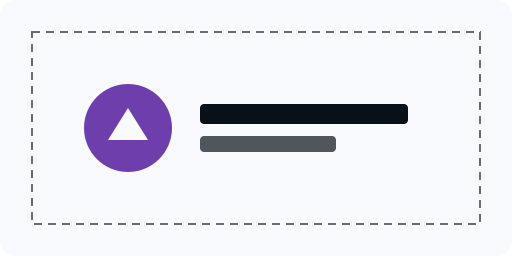
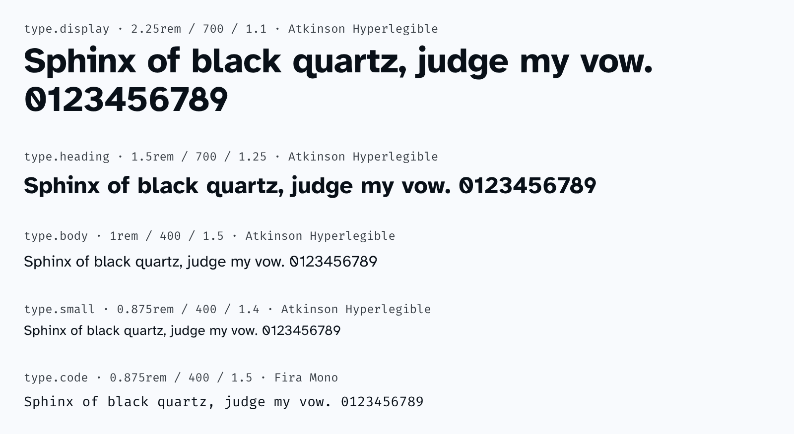
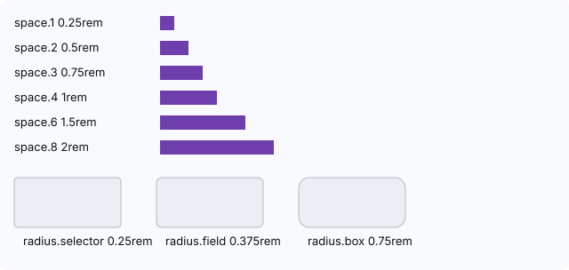
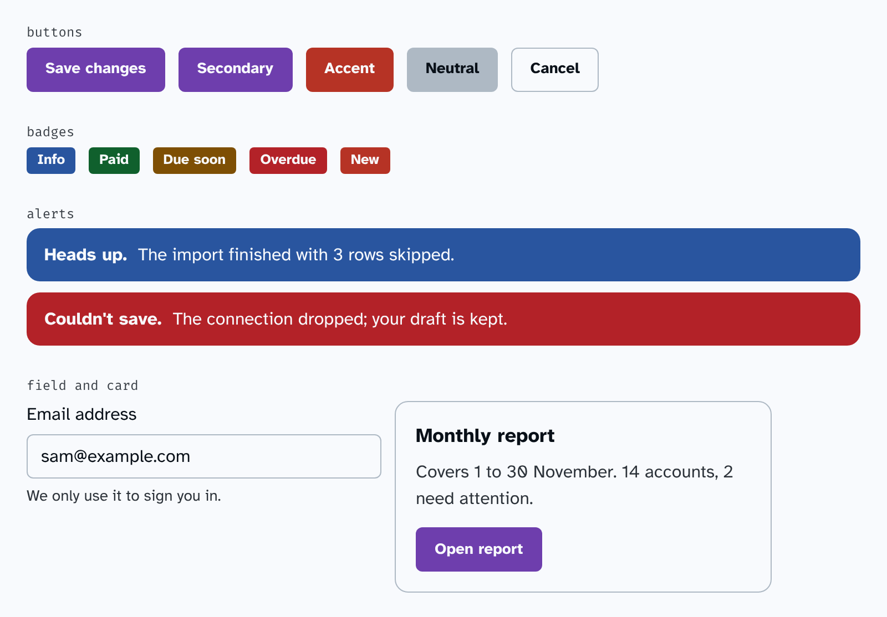

<!-- Generated by brandkit from tokens/sub.resolver.json. Don't edit by hand. -->

# Fixture Sub

A generic brand that extends Fixture Base through a resolver set, with a legacy tokens.css template.

Themes: Night (default), Day. Pictures follow your GitHub theme: dark shows Night, light shows Day. Values are in the tables.

Source: [`tokens/sub.resolver.json`](tokens/sub.resolver.json) (DTCG 2025.10). Every file below is generated by `brandkit build`; `brandkit check` checks the rules.

1. [Logo and clear space](#logo-and-clear-space)
2. [Colour](#colour)
3. [Type](#type)
4. [Spacing and radius](#spacing-and-radius)
5. [Icons](#icons)
6. [Components](#components)
7. [Do and don't](#do-and-dont)
8. [Install](#install)

## Logo and clear space

Use the lockup made for the ground it sits on:

| Theme | Lockup |
|---|---|
| Night | [`assets/lockup-night.svg`](assets/lockup-night.svg) |
| Day | [`assets/lockup-day.svg`](assets/lockup-day.svg) |

<picture>
  <source media="(prefers-color-scheme: dark)" srcset="export/sheet/clearspace-night.svg">
  
</picture>

**Clear space:** 0.5× the mark height on every side (the dashed box). Keep half the mark's height clear on every side of the lockup.

The mark on its own: [`assets/mark.svg`](assets/mark.svg).

## Colour

Roles first: use these, through the DaisyUI classes (`bg-base-100`, `text-base-content`, `btn-primary`) or the custom properties, never raw values.

| Role | Use | CSS | Night | Day |
|---|---|---|---|---|
| `color.bg` | page background | `--color-bg` |  `#091018`<br><sub>oklch(0.17 0.02 250) ← `palette.ink-950`</sub> |  `#f8fafd`<br><sub>oklch(0.985 0.004 250) ← `palette.ink-50`</sub> |
| `color.surface` | cards, panels | `--color-surface` |  `#0f1923`<br><sub>oklch(0.21 0.025 250) ← `palette.ink-900`</sub> |  `#ebeff4`<br><sub>oklch(0.95 0.008 250) ← `palette.ink-100`</sub> |
| `color.surface-raised` | menus, popovers | `--color-surface-raised` |  `#192532`<br><sub>oklch(0.26 0.03 250) ← `palette.ink-800`</sub> |  `#f8fafd`<br><sub>oklch(0.985 0.004 250) ← `palette.ink-50`</sub> |
| `color.border` | dividers, field outlines | `--color-border` |  `#313f4d`<br><sub>oklch(0.36 0.03 250) ← `palette.ink-700`</sub> |  `#aeb9c4`<br><sub>oklch(0.78 0.02 250) ← `palette.ink-300`</sub> |
| `color.text` | body text | `--color-text` |  `#f8fafd`<br><sub>oklch(0.985 0.004 250) ← `palette.ink-50`</sub> |  `#091018`<br><sub>oklch(0.17 0.02 250) ← `palette.ink-950`</sub> |
| `color.text-muted` | secondary text | `--color-text-muted` |  `#aeb9c4`<br><sub>oklch(0.78 0.02 250) ← `palette.ink-300`</sub> |  `#313f4d`<br><sub>oklch(0.36 0.03 250) ← `palette.ink-700`</sub> |
| `color.link` | links | `--color-link` |  `#c8aefa`<br><sub>oklch(0.8 0.11 300) ← `palette.violet-300`</sub> |  `#6e3ead`<br><sub>oklch(0.48 0.17 300) ← `palette.violet-700`</sub> |
| `color.primary` | primary buttons | `--color-primary` |  `#c8aefa`<br><sub>oklch(0.8 0.11 300) ← `palette.violet-300`</sub> |  `#6e3ead`<br><sub>oklch(0.48 0.17 300) ← `palette.violet-700`</sub> |
| `color.on-primary` | text on primary | `--color-on-primary` |  `#091018`<br><sub>oklch(0.17 0.02 250) ← `palette.ink-950`</sub> |  `#f8fafd`<br><sub>oklch(0.985 0.004 250) ← `palette.ink-50`</sub> |
| `color.accent` | highlights, large headings | `--color-accent` |  `#ff987e`<br><sub>oklch(0.78 0.13 35) ← `palette.coral-300`</sub> |  `#b63325`<br><sub>oklch(0.52 0.17 30) ← `palette.coral-700`</sub> |
| `color.on-accent` | text on accent | `--color-on-accent` |  `#091018`<br><sub>oklch(0.17 0.02 250) ← `palette.ink-950`</sub> |  `#f8fafd`<br><sub>oklch(0.985 0.004 250) ← `palette.ink-50`</sub> |
| `color.success` | success | `--color-success` |  `#7fe196`<br><sub>oklch(0.83 0.14 150) ← `palette.green-300`</sub> |  `#10602d`<br><sub>oklch(0.43 0.11 150) ← `palette.green-800`</sub> |
| `color.warning` | warning | `--color-warning` |  `#fcd76f`<br><sub>oklch(0.89 0.13 90) ← `palette.amber-200`</sub> |  `#7e4f04`<br><sub>oklch(0.47 0.1 70) ← `palette.amber-800`</sub> |
| `color.danger` | errors, destructive actions | `--color-danger` |  `#fe8a88`<br><sub>oklch(0.76 0.14 22) ← `palette.red-300`</sub> |  `#b32228`<br><sub>oklch(0.5 0.18 25) ← `palette.red-700`</sub> |
| `color.info` | information | `--color-info` |  `#9dc9f7`<br><sub>oklch(0.82 0.08 250) ← `palette.blue-300`</sub> |  `#29559f`<br><sub>oklch(0.46 0.13 260) ← `palette.blue-700`</sub> |
| `color.on-status` | text on status colours | `--color-on-status` |  `#091018`<br><sub>oklch(0.17 0.02 250) ← `palette.ink-950`</sub> |  `#f8fafd`<br><sub>oklch(0.985 0.004 250) ← `palette.ink-50`</sub> |
| `color.focus` | focus ring | `--color-focus` |  `#fcd76f`<br><sub>oklch(0.89 0.13 90) ← `palette.amber-200`</sub> |  `#00696f`<br><sub>oklch(0.47 0.09 200) ← `palette.teal-700`</sub> |

### Contrast

Every pair the brand declares, then the pairs brandkit adds itself: each DaisyUI colour's `-content` text on it, and `base-content` on `base-100`. Ratios are WCAG 2.x; `brandkit check` fails below the minimum. A `daisyui:` colour is whichever token that theme's DaisyUI mapping gives it, named under the ratio.

| Text | On | Use | Minimum | Night | Day |
|---|---|---|---|---|---|
| `color.text` | `color.bg` | body text | 4.5:1 | 18.28:1 passes | 18.28:1 passes |
| `color.text` | `color.surface` | text on cards | 4.5:1 | 16.97:1 passes | 16.55:1 passes |
| `color.text-muted` | `color.bg` | secondary text | 4.5:1 | 9.59:1 passes | 10.31:1 passes |
| `color.text-muted` | `color.surface` | secondary text on cards | 4.5:1 | 8.90:1 passes | 9.33:1 passes |
| `color.link` | `color.bg` | links | 4.5:1 | 9.91:1 passes | 6.80:1 passes |
| `color.on-primary` | `color.primary` | primary buttons | 4.5:1 | 9.91:1 passes | 6.80:1 passes |
| `color.on-accent` | `color.accent` | accent badges | 4.5:1 | 9.14:1 passes | 5.76:1 passes |
| `color.accent` | `color.bg` | large accent headings | 3:1 | 9.14:1 passes | 5.76:1 passes |
| `color.on-status` | `color.success` | success alerts | 4.5:1 | 11.93:1 passes | 7.35:1 passes |
| `color.on-status` | `color.warning` | warning alerts | 4.5:1 | 13.73:1 passes | 6.68:1 passes |
| `color.on-status` | `color.danger` | error alerts | 4.5:1 | 8.38:1 passes | 6.32:1 passes |
| `color.on-status` | `color.info` | info alerts | 4.5:1 | 11.04:1 passes | 6.94:1 passes |
| `color.focus` | `color.bg` | focus ring | 3:1 | 13.73:1 passes | 6.18:1 passes |
| `daisyui:base-content` | `daisyui:base-100` | DaisyUI base-content on base-100, added by brandkit | 4.5:1 | 18.28:1 passes<br><sub>`color.text` on `color.bg`</sub> | 18.28:1 passes<br><sub>`color.text` on `color.bg`</sub> |
| `daisyui:primary-content` | `daisyui:primary` | DaisyUI primary-content on primary, added by brandkit | 4.5:1 | 9.91:1 passes<br><sub>`color.on-primary` on `color.primary`</sub> | 6.80:1 passes<br><sub>`color.on-primary` on `color.primary`</sub> |
| `daisyui:secondary-content` | `daisyui:secondary` | DaisyUI secondary-content on secondary, added by brandkit | 4.5:1 | 9.91:1 passes<br><sub>`color.on-primary` on `color.link`</sub> | 6.80:1 passes<br><sub>`color.on-primary` on `color.link`</sub> |
| `daisyui:accent-content` | `daisyui:accent` | DaisyUI accent-content on accent, added by brandkit | 4.5:1 | 9.14:1 passes<br><sub>`color.on-accent` on `color.accent`</sub> | 5.76:1 passes<br><sub>`color.on-accent` on `color.accent`</sub> |
| `daisyui:neutral-content` | `daisyui:neutral` | DaisyUI neutral-content on neutral, added by brandkit | 4.5:1 | 10.31:1 passes<br><sub>`color.text` on `color.border`</sub> | 9.59:1 passes<br><sub>`color.text` on `color.border`</sub> |
| `daisyui:info-content` | `daisyui:info` | DaisyUI info-content on info, added by brandkit | 4.5:1 | 11.04:1 passes<br><sub>`color.on-status` on `color.info`</sub> | 6.94:1 passes<br><sub>`color.on-status` on `color.info`</sub> |
| `daisyui:success-content` | `daisyui:success` | DaisyUI success-content on success, added by brandkit | 4.5:1 | 11.93:1 passes<br><sub>`color.on-status` on `color.success`</sub> | 7.35:1 passes<br><sub>`color.on-status` on `color.success`</sub> |
| `daisyui:warning-content` | `daisyui:warning` | DaisyUI warning-content on warning, added by brandkit | 4.5:1 | 13.73:1 passes<br><sub>`color.on-status` on `color.warning`</sub> | 6.68:1 passes<br><sub>`color.on-status` on `color.warning`</sub> |
| `daisyui:error-content` | `daisyui:error` | DaisyUI error-content on error, added by brandkit | 4.5:1 | 8.38:1 passes<br><sub>`color.on-status` on `color.danger`</sub> | 6.32:1 passes<br><sub>`color.on-status` on `color.danger`</sub> |

<details>
<summary>Other colours: 22 tokens not in the roles table</summary>

| Token | CSS | Night | Day |
|---|---|---|---|
| `palette.ink-950` | `--palette-ink-950` |  `#091018`<br><sub>oklch(0.17 0.02 250)</sub> |  `#091018`<br><sub>oklch(0.17 0.02 250)</sub> |
| `palette.ink-900` | `--palette-ink-900` |  `#0f1923`<br><sub>oklch(0.21 0.025 250)</sub> |  `#0f1923`<br><sub>oklch(0.21 0.025 250)</sub> |
| `palette.ink-800` | `--palette-ink-800` |  `#192532`<br><sub>oklch(0.26 0.03 250)</sub> |  `#192532`<br><sub>oklch(0.26 0.03 250)</sub> |
| `palette.ink-700` | `--palette-ink-700` |  `#313f4d`<br><sub>oklch(0.36 0.03 250)</sub> |  `#313f4d`<br><sub>oklch(0.36 0.03 250)</sub> |
| `palette.ink-500` | `--palette-ink-500` |  `#657383`<br><sub>oklch(0.55 0.03 250)</sub> |  `#657383`<br><sub>oklch(0.55 0.03 250)</sub> |
| `palette.ink-300` | `--palette-ink-300` |  `#aeb9c4`<br><sub>oklch(0.78 0.02 250)</sub> |  `#aeb9c4`<br><sub>oklch(0.78 0.02 250)</sub> |
| `palette.ink-100` | `--palette-ink-100` |  `#ebeff4`<br><sub>oklch(0.95 0.008 250)</sub> |  `#ebeff4`<br><sub>oklch(0.95 0.008 250)</sub> |
| `palette.ink-50` | `--palette-ink-50` |  `#f8fafd`<br><sub>oklch(0.985 0.004 250)</sub> |  `#f8fafd`<br><sub>oklch(0.985 0.004 250)</sub> |
| `palette.teal-300` | `--palette-teal-300` |  `#60dbd4`<br><sub>oklch(0.82 0.11 190)</sub> |  `#60dbd4`<br><sub>oklch(0.82 0.11 190)</sub> |
| `palette.teal-700` | `--palette-teal-700` |  `#00696f`<br><sub>oklch(0.47 0.09 200)</sub> |  `#00696f`<br><sub>oklch(0.47 0.09 200)</sub> |
| `palette.coral-300` | `--palette-coral-300` |  `#ff987e`<br><sub>oklch(0.78 0.13 35)</sub> |  `#ff987e`<br><sub>oklch(0.78 0.13 35)</sub> |
| `palette.coral-700` | `--palette-coral-700` |  `#b63325`<br><sub>oklch(0.52 0.17 30)</sub> |  `#b63325`<br><sub>oklch(0.52 0.17 30)</sub> |
| `palette.green-300` | `--palette-green-300` |  `#7fe196`<br><sub>oklch(0.83 0.14 150)</sub> |  `#7fe196`<br><sub>oklch(0.83 0.14 150)</sub> |
| `palette.green-800` | `--palette-green-800` |  `#10602d`<br><sub>oklch(0.43 0.11 150)</sub> |  `#10602d`<br><sub>oklch(0.43 0.11 150)</sub> |
| `palette.amber-200` | `--palette-amber-200` |  `#fcd76f`<br><sub>oklch(0.89 0.13 90)</sub> |  `#fcd76f`<br><sub>oklch(0.89 0.13 90)</sub> |
| `palette.amber-800` | `--palette-amber-800` |  `#7e4f04`<br><sub>oklch(0.47 0.1 70)</sub> |  `#7e4f04`<br><sub>oklch(0.47 0.1 70)</sub> |
| `palette.red-300` | `--palette-red-300` |  `#fe8a88`<br><sub>oklch(0.76 0.14 22)</sub> |  `#fe8a88`<br><sub>oklch(0.76 0.14 22)</sub> |
| `palette.red-700` | `--palette-red-700` |  `#b32228`<br><sub>oklch(0.5 0.18 25)</sub> |  `#b32228`<br><sub>oklch(0.5 0.18 25)</sub> |
| `palette.blue-300` | `--palette-blue-300` |  `#9dc9f7`<br><sub>oklch(0.82 0.08 250)</sub> |  `#9dc9f7`<br><sub>oklch(0.82 0.08 250)</sub> |
| `palette.blue-700` | `--palette-blue-700` |  `#29559f`<br><sub>oklch(0.46 0.13 260)</sub> |  `#29559f`<br><sub>oklch(0.46 0.13 260)</sub> |
| `palette.violet-300` | `--palette-violet-300` |  `#c8aefa`<br><sub>oklch(0.8 0.11 300)</sub> |  `#c8aefa`<br><sub>oklch(0.8 0.11 300)</sub> |
| `palette.violet-700` | `--palette-violet-700` |  `#6e3ead`<br><sub>oklch(0.48 0.17 300)</sub> |  `#6e3ead`<br><sub>oklch(0.48 0.17 300)</sub> |

</details>

## Type

<picture>
  <source media="(prefers-color-scheme: dark)" srcset="export/sheet/type-night.png">
  
</picture>

| Role | Stack |
|---|---|
| mono | `"Fira Mono", ui-monospace, monospace` |
| sans | `"Atkinson Hyperlegible", system-ui, sans-serif` |

| Token | Size | Weight | Line height | Letter spacing | Family | Use |
|---|---|---|---|---|---|---|
| `type.display` | 2.25rem | 700 | 1.1 | -0.02rem | Atkinson Hyperlegible | Page titles. |
| `type.heading` | 1.5rem | 700 | 1.25 | 0 | Atkinson Hyperlegible | Section headings. |
| `type.body` | 1rem | 400 | 1.5 | 0 | Atkinson Hyperlegible | Running text. |
| `type.small` | 0.875rem | 400 | 1.4 | 0.01rem | Atkinson Hyperlegible | Captions and table cells. |
| `type.code` | 0.875rem | 400 | 1.5 | 0 | Fira Mono | Code and IDs. |

Fonts shipped with the package: Atkinson Hyperlegible ([`vendor/fixture-base/fonts/fonts.css`](vendor/fixture-base/fonts/fonts.css), [licence](vendor/fixture-base/fonts/OFL-AtkinsonHyperlegible.txt)); Fira Mono ([`vendor/fixture-base/fonts/fonts.css`](vendor/fixture-base/fonts/fonts.css), [licence](vendor/fixture-base/fonts/OFL-FiraMono.txt)).

## Spacing and radius

<picture>
  <source media="(prefers-color-scheme: dark)" srcset="export/sheet/scale-night.svg">
  
</picture>

| Token | Value |
|---|---|
| `space.1` | `0.25rem` |
| `space.2` | `0.5rem` |
| `space.3` | `0.75rem` |
| `space.4` | `1rem` |
| `space.6` | `1.5rem` |
| `space.8` | `2rem` |
| `radius.selector` | `0.25rem` |
| `radius.field` | `0.375rem` |
| `radius.box` | `0.75rem` |

## Icons

**Set:** lucide, stroke width 2, drawn in `currentColor` so they take the text colour.

**In code:** `<.icon name="lucide-…" /> in HEEx; embedded Lucide SVGs drawn with currentColor elsewhere`.

Common names: [`lucide-house`](https://lucide.dev/icons/house), [`lucide-search`](https://lucide.dev/icons/search), [`lucide-settings`](https://lucide.dev/icons/settings), [`lucide-circle-alert`](https://lucide.dev/icons/circle-alert).

`brandkit lint` rule R9 flags icons from another set and hand-drawn inline SVG paths in templates.

## Components

<picture>
  <source media="(prefers-color-scheme: dark)" srcset="export/sheet/components-night.png">
  
</picture>

Drawn from the DaisyUI theme variables (`--color-*`, `--radius-*`, `--border`) that `brandkit build` writes.

## Do and don't

| Do | Don't |
|---|---|
| Use violet for the primary action only; everything else follows the base brand. | No shadows or glows: separate surfaces with color.border and color.surface. |
|  | Don't set the accent on body text. |
|  | Don't stretch, recolour or crowd the lockup. |

**Accent:** The accent marks highlights and large headings, never running text.

**Shadows:** none. The Tailwind theme removes the shadow utilities and `brandkit lint` rule R7 flags any that remain.

## Install

```sh
mise use github:shermanhuman/brandkit
brandkit install example/fixture-sub-brand@<tag>   # vendors the files below and writes brandkit.lock
brandkit update                     # moves to the newest tag
```

| File | What it's for |
|---|---|
| [`export/ui/tokens.css`](export/ui/tokens.css) | colour custom properties, per theme |
| [`export/ui/brand.css`](export/ui/brand.css) | type, spacing, radius and motion custom properties |
| [`export/ui/daisyui-themes.css`](export/ui/daisyui-themes.css) | DaisyUI themes for a prebuilt `daisyui.css` (`[data-theme]` blocks) |
| [`export/ui/daisyui-plugin.css`](export/ui/daisyui-plugin.css) | DaisyUI themes for Tailwind 4 with vendored `daisyui.js` (`@plugin` blocks; removes Tailwind's default palette) |
| [`export/lint.json`](export/lint.json) | what `brandkit lint` checks against |

Select a theme on `<html>`. The files don't all switch on the same selector, so use the one for the files the page loads:

| Theme | [`export/ui/daisyui-themes.css`](export/ui/daisyui-themes.css), [`export/ui/daisyui-plugin.css`](export/ui/daisyui-plugin.css) | [`export/ui/tokens.css`](export/ui/tokens.css), [`export/ui/brand.css`](export/ui/brand.css) |
|---|---|---|
| Night | `data-theme="fixture-sub"` or none (the default) | `:root` (the default: no attribute needed) |
| Day | `data-theme="fixture-sub-day"` | `[data-theme="light"]` |
